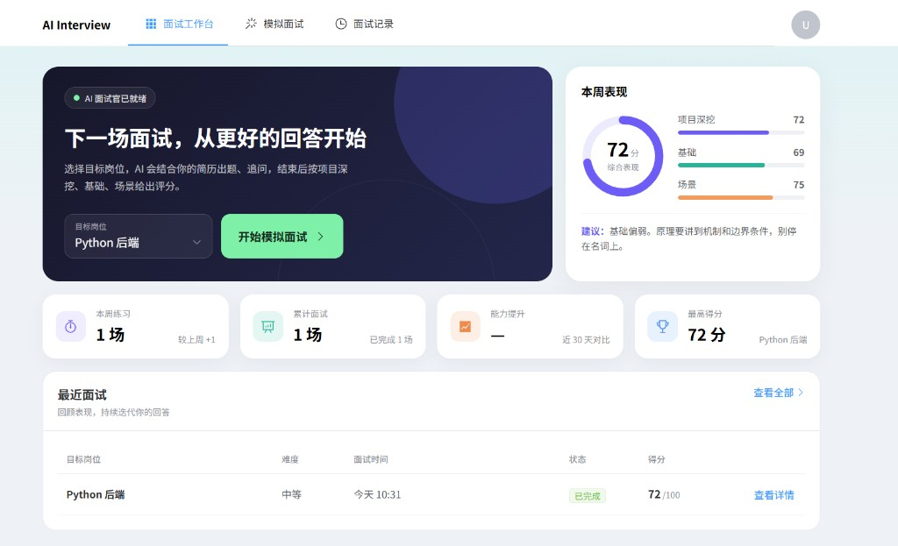
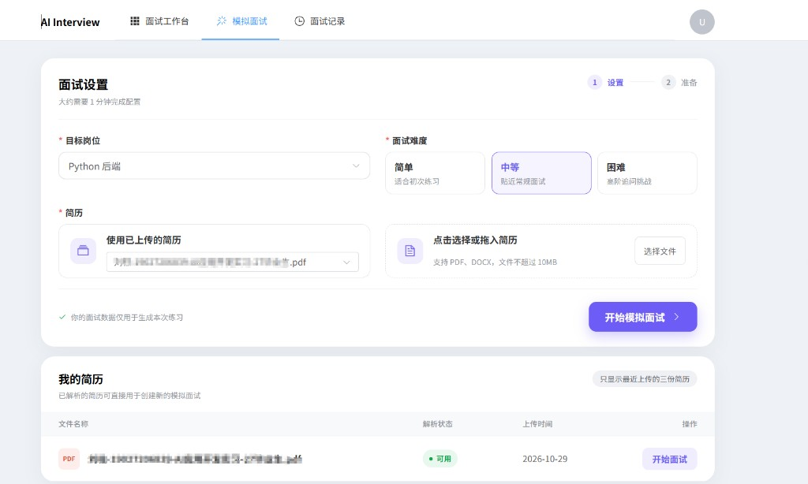
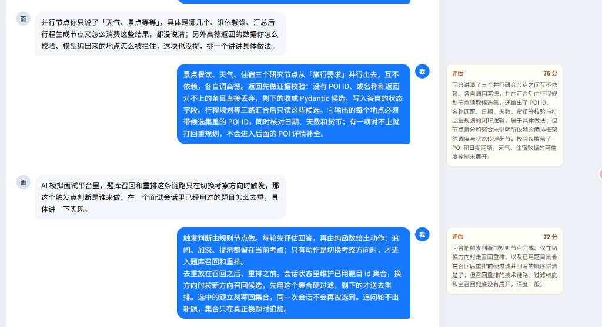
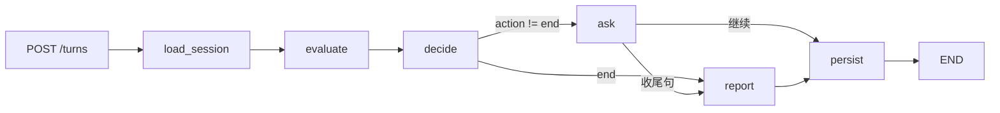

# 智面

根据简历做模拟面试：先生成这场要考的计划，再按回答追问、换题或收尾。题库是考点卡，提供要点和追问路线，不把原题念给候选人。

后端 FastAPI，前端 Vue。档案在 MySQL，验证码和刷新令牌在 Redis。

## LangGraph 编排

整场面试不是一张跑很久的图。用户每提交一次回答，FastAPI 从 MySQL 组装本轮 State，对已编译的 `turn_graph` 做一次 `ainvoke`，把结果写回 MySQL，图结束。不用 LangGraph checkpointer 当档案；刷新或重启都从库恢复。

图在进程启动时 `compile()` 一次，挂在 `app.state`。节点里继续用现有的 `AsyncOpenAI` 客户端。

| 节点 | 谁做 | 做什么 |
| --- | --- | --- |
| `load_session` | 代码 | 读场次、最近轮次、当前考点卡 |
| `evaluate` | 模型 | 对照要点评估这一轮，给出覆盖、深度、分数和点评 |
| `decide` | Python 规则 | 决定追问、加深、提示、换阶段还是结束；条件边只看这里写出的 `action` |
| `ask` | 模型 | 按指定动作生成下一问，可流式输出 |
| `report` | Python 规则 | 按阶段加权汇总总分 |
| `persist` | 代码 | 最后写库；失败则整轮不提交 |

模型只负责评估这一轮，以及把问题说得自然。「下一步问什么」由规则锁死，不交给模型选边。

创建场次仍是普通服务函数（选卡、生成计划、出第一问），尚未收成 `plan_graph`。设计说明见 `docs/interview-design.md`。
