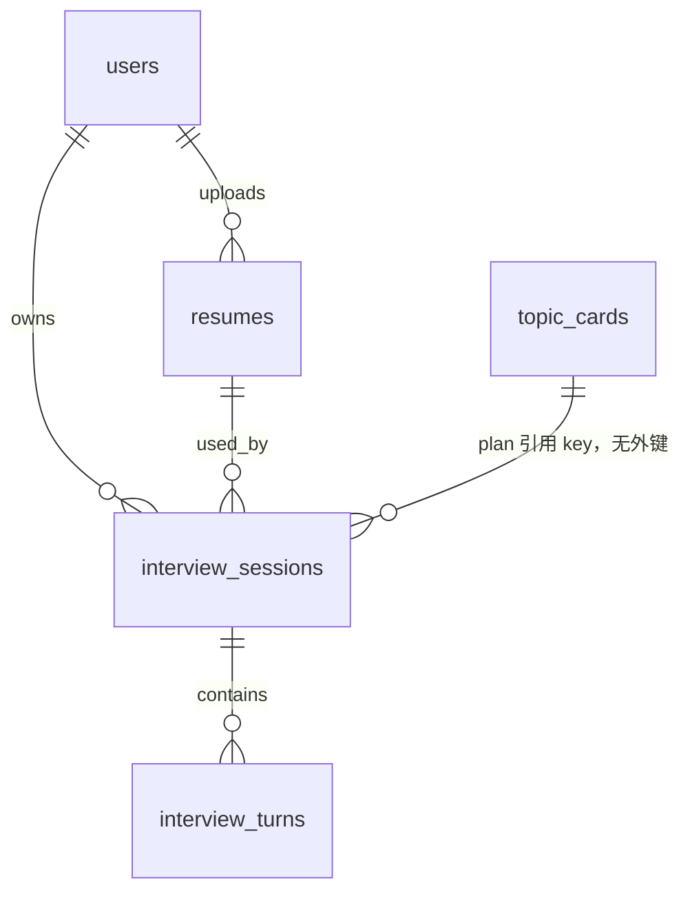

# 数据库设计

本文件记录当前的表、字段、关系和迁移。建表规则见 `docs/rules/database.md`。

实际表结构以 Alembic 迁移脚本为准。尚未迁移的表在对应小节标明「待建」。

## 表清单

| 表名 | 业务含义 | 主键 | 备注 |
| --- | --- | --- | --- |
| `users` | 注册用户 | `id` | 密码只存哈希 |
| `resumes` | 用户上传的简历 | `id` | 原文和结构化资料 |
| `topic_cards` | 面试考点卡 | `id` | 全局素材，不挂用户 |
| `interview_sessions` | 一场模拟面试 | `id` | 开场前写入计划和简历快照 |
| `interview_turns` | 一场面试中的一轮问答 | `id` | 评估和问题按轮保存。待答时 `answer` 为空字符串 |

验证码、刷新令牌和短期限流放 Redis，不建表。

## 表结构

### `users`

用途：保存注册账号。验证码和短期令牌不进这张表。

| 字段 | 类型 | 必填 | 默认值 | 说明 | 索引/约束 |
| --- | --- | --- | --- | --- | --- |
| `id` | `BIGINT UNSIGNED` | 是 | 自增 | 主键 | `PRIMARY KEY` |
| `email` | `VARCHAR(255)` | 是 | 无 | 登录邮箱。排序规则 `utf8mb4_0900_as_cs`，区分大小写。敏感 | `uq_users_email` |
| `password_hash` | `VARCHAR(255)` | 是 | 无 | 密码哈希，不明文存储。敏感 |  |
| `created_at` | `DATETIME(6)` | 是 | 无 | 创建时间，由应用写入 UTC |  |
| `updated_at` | `DATETIME(6)` | 是 | 无 | 更新时间，由应用写入 UTC |  |

### `resumes`

用途：保存用户上传的简历文件、提取出的原文和结构化资料。一场面试创建时会把当时的 `profile` 拷进 `interview_sessions.resume_snapshot`，之后改简历不影响已开始的场次。

| 字段 | 类型 | 必填 | 默认值 | 说明 | 索引/约束 |
| --- | --- | --- | --- | --- | --- |
| `id` | `BIGINT UNSIGNED` | 是 | 自增 | 主键 | `PRIMARY KEY` |
| `user_id` | `BIGINT UNSIGNED` | 是 | 无 | 所属用户 | `fk_resumes_user_id_users` |
| `original_filename` | `VARCHAR(255)` | 是 | 无 | 上传时的文件名 |  |
| `storage_path` | `VARCHAR(255)` | 是 | 无 | 相对 `RESUME_UPLOAD_DIR` 的存储路径，形如 `{user_id}/{id}.pdf` |  |
| `media_type` | `VARCHAR(127)` | 是 | 无 | `application/pdf` 或 Word 的 OOXML 类型 |  |
| `status` | `VARCHAR(32)` | 是 | 无 | `ready`：结构化完成，可用于开场；`failed`：解析或结构化失败 |  |
| `raw_text` | `MEDIUMTEXT` | 否 | 空 | 从文件抽出的原文。失败或尚未抽出时为空 |  |
| `profile` | `JSON` | 否 | 空 | 结构化资料。失败时为空。字段见下方 |  |
| `error_detail` | `VARCHAR(512)` | 否 | 空 | 失败原因，成功时为空 |  |
| `created_at` | `DATETIME(6)` | 是 | 无 | 创建时间，由应用写入 UTC |  |
| `updated_at` | `DATETIME(6)` | 是 | 无 | 更新时间，由应用写入 UTC |  |

`profile` 结构（`ResumeProfile`）：

```json
{
  "name": "张三",
  "education": [{"school": "", "degree": null, "major": null, "start": null, "end": null}],
  "experience": [{"company": "", "title": null, "start": null, "end": null, "highlights": []}],
  "projects": [{"name": "", "role": null, "highlights": []}],
  "skills": ["Java", "MySQL"]
}
```

原文没有的字段用 `null` 或空数组。模型不得编造经历。

允许的文件：`.pdf`、`.docx`。单个文件不超过 10MB，抽出文本不超过 20000 字。

### `topic_cards`

用途：保存面试考点卡。计划生成和评估读取这些卡片；出题时不把卡片原文念给用户。种子数据在 `backend/data/topic_cards.json`，用 `backend/scripts/import_topic_cards.py` 按 `key` 导入。

| 字段 | 类型 | 必填 | 默认值 | 说明 | 索引/约束 |
| --- | --- | --- | --- | --- | --- |
| `id` | `BIGINT UNSIGNED` | 是 | 自增 | 主键 | `PRIMARY KEY` |
| `key` | `VARCHAR(64)` | 是 | 无 | 稳定 slug，计划里引用这个值而不是自增 id | `uq_topic_cards_key` |
| `name` | `VARCHAR(128)` | 是 | 无 | 考点名称 |  |
| `summary` | `VARCHAR(255)` | 是 | 无 | 计划生成用的短摘要，不进用户问题 |  |
| `difficulty` | `VARCHAR(32)` | 是 | 无 | `easy` / `medium` / `hard` |  |
| `role_tags` | `JSON` | 是 | 无 | 岗位标签字符串数组，例如 `["backend","java"]` |  |
| `skill_tags` | `JSON` | 是 | 无 | 技能标签字符串数组，小写 slug |  |
| `key_points` | `JSON` | 是 | 无 | `[{id, text}]`，评估和报告依据 |  |
| `probe_path` | `JSON` | 是 | 无 | `[{id, intent}]`，追问意图，不是题面 |  |
| `pitfalls` | `JSON` | 是 | 无 | 常见误区字符串数组 |  |
| `status` | `VARCHAR(32)` | 是 | 无 | `draft` / `published`。检索只取 `published` |  |
| `content_hash` | `VARCHAR(64)` | 是 | 无 | 规范化正文的 SHA-256，导入时计算，供以后同步向量 |  |
| `created_at` | `DATETIME(6)` | 是 | 无 | 创建时间，由应用写入 UTC |  |
| `updated_at` | `DATETIME(6)` | 是 | 无 | 更新时间，由应用写入 UTC |  |

无对外 CRUD 接口。向量库未接入；`content_hash` 变化时才需要重新 embedding。

### `interview_sessions`

用途：一场模拟面试的档案。无论一轮内部是否用 LangGraph 编排，开场前都要写入这张表。用户刷新或进程重启后，从这里恢复，不从图的运行时恢复。

| 字段 | 类型 | 必填 | 默认值 | 说明 | 索引/约束 |
| --- | --- | --- | --- | --- | --- |
| `id` | `BIGINT UNSIGNED` | 是 | 自增 | 主键 | `PRIMARY KEY` |
| `user_id` | `BIGINT UNSIGNED` | 是 | 无 | 面试所属用户 | `fk_interview_sessions_user_id` |
| `resume_id` | `BIGINT UNSIGNED` | 是 | 无 | 开场时使用的简历。删除简历时默认限制 | `fk_interview_sessions_resume_id` |
| `target_role` | `VARCHAR(128)` | 是 | 无 | 目标岗位，自由文本，例如「Java 后端」 |  |
| `difficulty` | `VARCHAR(32)` | 是 | 无 | `easy` / `medium` / `hard`，与考点卡一致 |  |
| `status` | `VARCHAR(32)` | 是 | 无 | `planned` / `in_progress` / `completed` / `abandoned`。给出第一问后为 `in_progress` |  |
| `resume_snapshot` | `JSON` | 是 | 无 | 开场时的 `ResumeProfile` 拷贝，后续改简历不影响本场 |  |
| `plan` | `JSON` | 是 | 无 | `InterviewPlan`，用户接口不返回 |  |
| `progress` | `JSON` | 是 | 无 | 当前阶段和下标，见下方 |  |
| `created_at` | `DATETIME(6)` | 是 | 无 | 创建时间，由应用写入 UTC |  |
| `updated_at` | `DATETIME(6)` | 是 | 无 | 更新时间，由应用写入 UTC |  |

`plan.stages[]`：

| 字段 | 说明 |
| --- | --- |
| `id` | 阶段稳定标识 |
| `kind` | `intro` / `project_probe` / `fundamentals` / `scenario` / `closing` |
| `goal` | 本阶段要考察什么 |
| `max_turns` | 1～8 |
| `source` | `resume` 或 `bank` |
| `resume_anchor` | 简历项目名或技能原文，可空 |
| `topic_card_key` | 考点卡 `key`，`source=bank` 时必填 |

`progress`：

```json
{
  "stage_index": 0,
  "turn_in_stage": 1,
  "consecutive_misses": 0,
  "used_card_keys": ["mysql-index-leftmost"]
}
```

当前迁移中的外键名是 `fk_interview_sessions_user_id`、`fk_interview_sessions_resume_id`，以及 `fk_interview_turn_session_id_interview_sessions`（表名用了单数 `turn`），未完全按 `fk_<表>_<列>_<引用表>`。新建外键仍按该规则。

### `interview_turns`

用途：一场面试中的每一轮。提交回答时写入 `answer` 和 `evaluation`，再插入下一轮（`answer` 为空字符串，表示正在等用户）。报告汇总这些评估并按阶段加权出总分，不再把整场对话交给模型。

| 字段 | 类型 | 必填 | 默认值 | 说明 | 索引/约束 |
| --- | --- | --- | --- | --- | --- |
| `id` | `BIGINT UNSIGNED` | 是 | 自增 | 主键 | `PRIMARY KEY` |
| `session_id` | `BIGINT UNSIGNED` | 是 | 无 | 所属场次。场次删除时级联删除轮次 | `fk_interview_turn_session_id_interview_sessions` |
| `seq` | `INT` | 是 | 无 | 场内从 1 递增 | `uq_interview_turn_session_id_seq` |
| `stage_index` | `INT` | 是 | 无 | 对应 `plan.stages` 下标，从 0 起 |  |
| `action` | `VARCHAR(255)` | 是 | 无 | `first` / `follow_up` / `deepen` / `hint` / `next_stage` / `end` |  |
| `question` | `VARCHAR(2048)` | 是 | 无 | 给用户看的问题 |  |
| `answer` | `VARCHAR(8000)` | 是 | 无 | 用户回答。空字符串表示本轮尚未作答。当前列为 `NOT NULL` |  |
| `evaluation` | `JSON` | 否 | 空 | 答完后的评估。`NULL` 表示尚未评估。完整结构不对用户返回；结束后 GET 只公开其中的 `score`、`comment` |  |
| `created_at` | `DATETIME(6)` | 是 | 无 | 创建时间，由应用写入 UTC |  |
| `updated_at` | `DATETIME(6)` | 是 | 无 | 更新时间，由应用写入 UTC |  |

`evaluation`：

```json
{
  "covered": ["p1"],
  "missing": ["p2"],
  "depth": "shallow",
  "vague_quotes": ["status 在左边就能用"],
  "said_dont_know": false,
  "off_topic": false,
  "score": 42,
  "comment": "本轮 42 分。讲到了最左前缀，但没说明范围查询为何走不成索引。"
}
```

`depth` 取值：`shallow` / `adequate` / `deep`。`score` 为 0～100，写入前由代码按深度、跑题、「不会」钳制，并与 `comment` 开头的分数对齐。轮次生命周期完全依附场次，外键使用 `ON DELETE CASCADE`。

## 表关系



- `resumes.user_id` → `users.id`，`ON DELETE RESTRICT`
- `interview_sessions.user_id` → `users.id`，`ON DELETE RESTRICT`
- `interview_sessions.resume_id` → `resumes.id`，`ON DELETE RESTRICT`
- `interview_turns.session_id` → `interview_sessions.id`，`ON DELETE CASCADE`
- `topic_cards` 是全局素材。计划用 `topic_card_key` 引用，不建外键，避免改卡或重导种子时卡住历史场次。

## Redis 键

| 键 | 用途 | 过期 |
| --- | --- | --- |
| `register:code:{email}` | 注册验证码 | 5 分钟 |
| `reset:code:{email}` | 重置密码验证码 | 5 分钟 |
| `token:refresh:{user_id}` | 当前有效的刷新令牌 | `JWT_REFRESH_TOKEN_EXPIRES_DAYS` |

## 索引

| 索引名 | 表 | 字段 | 类型 | 用途 |
| --- | --- | --- | --- | --- |
| `uq_users_email` | `users` | `email` | 唯一 | 禁止重复邮箱。比较时区分大小写 |
| `fk_resumes_user_id_users` | `resumes` | `user_id` | 外键 | 按用户查简历 |
| `uq_topic_cards_key` | `topic_cards` | `key` | 唯一 | 禁止重复考点 slug |
| `fk_interview_sessions_user_id` | `interview_sessions` | `user_id` | 外键 | 按用户查场次 |
| `fk_interview_sessions_resume_id` | `interview_sessions` | `resume_id` | 外键 | 限制删除仍被引用的简历 |
| `fk_interview_turn_session_id_interview_sessions` | `interview_turns` | `session_id` | 外键 | 按场次拉轮次。命名按当时模型，未带表名复数 |
| `uq_interview_turn_session_id_seq` | `interview_turns` | `session_id, seq` | 唯一 | 同一场序号不重复 |

## 数据迁移

| 迁移版本 | 日期 | 内容 | 回滚方案 | 状态 |
| --- | --- | --- | --- | --- |
| `cc267a266b69` | 2026-10-12 | 创建 `users` 表 | `alembic downgrade` 到空库，删除 `users` | 已执行 |
| `54098f4c206e` | 2026-10-18 | 创建 `resumes` 表 | `alembic downgrade -1`，删除 `resumes` | 已执行 |
| `3f212b686956` | 2026-10-20 | 创建 `interview_sessions` 表 | `alembic downgrade -1`，删除 `interview_sessions` | 已执行 |
| `a41683e0a265` | 2026-10-20 | 创建 `topic_cards` 表 | `alembic downgrade -1`，删除 `topic_cards` | 已执行 |
| `1ce649d360ab` | 2026-10-21 | 创建 `interview_turns` 表 | `alembic downgrade -1`，删除 `interview_turns` | 已执行 |

升级：在 `backend/` 执行 `alembic upgrade head`。当前 head 为 `1ce649d360ab`。库中已有 `users`、`resumes`、`interview_sessions`、`topic_cards`、`interview_turns`。

种子：迁移完成后执行 `python scripts/import_topic_cards.py`。

## 数据安全与保留

- 密码只存哈希，不明文存储。
- 验证码和刷新令牌只在 Redis，响应中不返回验证码。
- 简历原文、结构化资料和面试回答含个人信息，接口按属主隔离。
- 访问权限和最小权限角色：待补充。
- 备份频率、保留周期和恢复演练：待补充。
- 数据删除、归档和合规要求：待补充。
