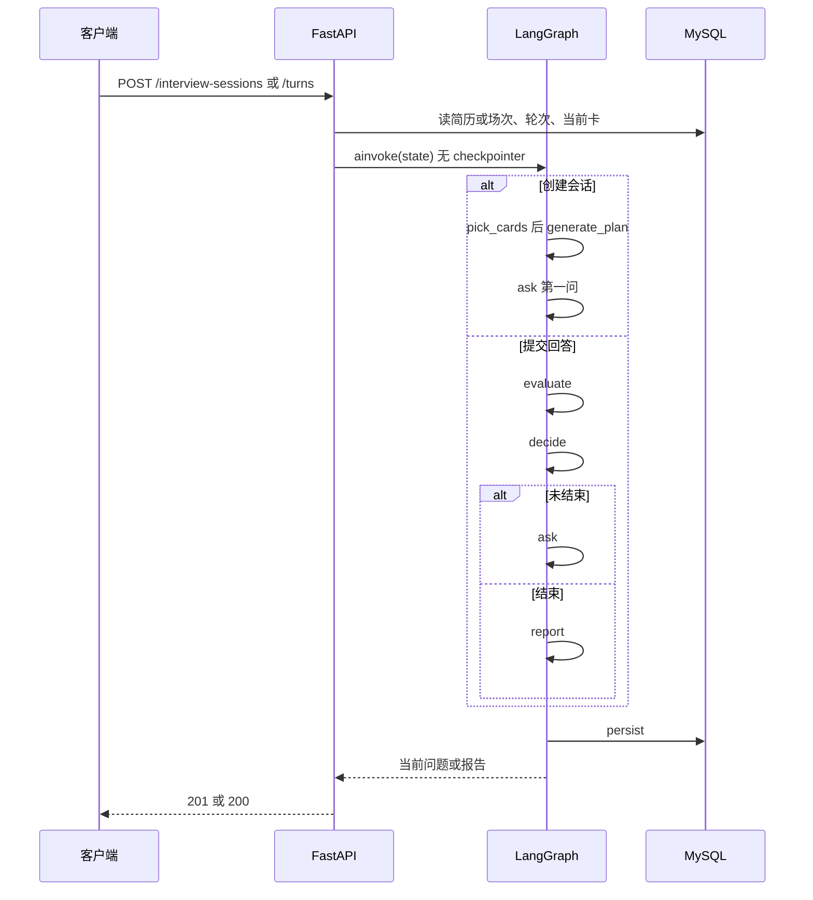
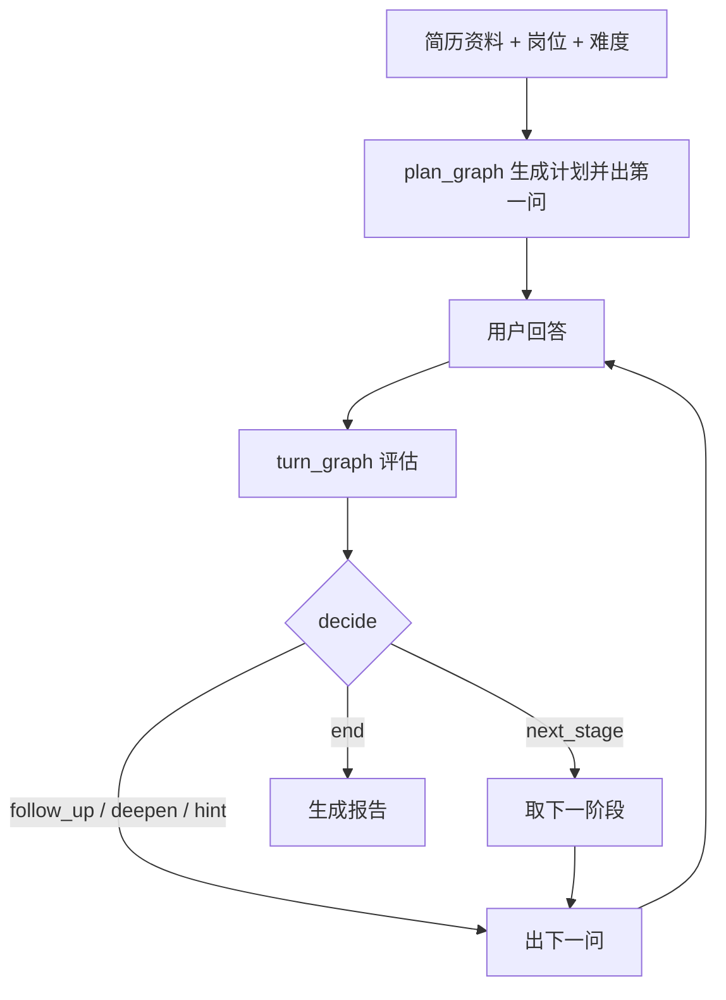

# 面试官设计

本文件记录 AI 模拟面试的出题与追问设计。目标是让面试像真人一样根据简历和刚才的回答推进，而不是用一个 API 加一段提示词自由发挥，也不是每轮都从题库抽固定题目。

简历处理、接口和表结构另见 `docs/api.md`、`docs/database.md`。本文件只约定面试官怎么工作。

## 原则

- 面试官手里先有一份这场要考的计划，问题从简历和上一轮回答里接出来。
- 答得好就往深处挖，答不上就给台阶或换方向。一个考点问够了，再转到下一个。
- 题库提供考点素材和评分依据，不直接把题目原文念给用户。
- 「下一步问什么」由代码里的规则决定，模型只负责评估这一轮、以及把问题说得自然。
- 一场面试的档案在 MySQL。LangGraph 只负责**一次 HTTP 请求内部**的节点编排和观测，不保存跨请求状态。

## 职责拆分

| 部分 | 谁做 | 做什么 |
| --- | --- | --- |
| 计划 | 开场前一次模型调用（`llm_model_heavy`） | 根据简历、岗位、难度和候选考点卡列出本场考点、顺序和每段最多几轮 |
| 评估 | 用户每答完一次模型调用（`llm_model_light`） | 判断覆盖了哪些要点、深度如何、哪里含糊、是否明确说了「不会」，并给出本轮分数和点评 |
| 分数闸 | Python 规则 | 把模型分钳到与 `depth` / 跑题 / 「不会」一致的区间，点评开头的分数必须等于该整数 |
| 总分 | Python 规则 | 各轮闸后分数按阶段平均，再按 `kind` 加权；开场和收尾不计分 |
| 流程控制 | Python 规则（图中的 `decide` 节点） | 决定追问、加深、给提示、换考点还是结束 |
| 措辞 | 另一次模型调用 | 按规则指定的动作生成下一问，不评价对错，不说出答案 |
| 题库 | 考点卡 | 提供要点、追问路线和常见误区；检索结果是素材，不是原题 |
| 档案 | MySQL | `interview_sessions` 存计划和进度，`interview_turns` 存问答和评估 |
| 编排与观测 | LangGraph + LangSmith | 一次请求跑完一张小图；节点入参、出参和耗时可回放 |

## 编排：一次 HTTP 跑一张图

不把整场面试做成一次长时间运行的图。用户每提交一次，FastAPI 从 MySQL 组装 State，`ainvoke` 一次，把结果写回 MySQL，图结束。不用 LangGraph checkpointer 当档案。LangSmith 的 `thread_id` 可以等于 `session_id`，只用来把同一场的多条 trace 串在一起看。

图在进程启动时 `compile()` 一次，挂在 `app.state`，与 `llm_client` 相同。请求里不要重建图。节点内继续使用现有 `AsyncOpenAI` 客户端，不另起一套 ChatModel。

建议两张小图：

| HTTP | 图 | 节点 |
| --- | --- | --- |
| `POST /api/v1/interview-sessions` | 计划流水线（尚未 `compile` 成 `plan_graph`） | `load_resume` → `pick_cards` → `generate_plan` → `ask` → `persist` |
| `POST /api/v1/interview-sessions/{id}/turns` | `turn_graph`（启动时 `compile()`，挂 `app.state`） | `load_session` → `evaluate` → `decide` → `ask` 或 `report` → `persist` |

`GET` 只读库，不跑图。



`turn_graph` 的条件边只看 `decide` 写出的 `action`：`end` 走 `report`，其余走 `ask`。`decide` 必须是普通函数节点，不要再交给模型选边。

图在这一轮内部转完就停。不要在图里等待用户下一次回答。

对的：`evaluate → decide → ask → persist → return`

错的：`ask → 等用户 → evaluate → …`（图跨过多次 HTTP）

`persist` 放在最后。失败则整轮不提交，避免评估写了、问题没写上。

### 一轮的 State

图的 State 是这一次调用的工作内存，不是档案。进图前从 `interview_sessions` 和 `interview_turns` 组装，出图后写回。

```python
class TurnState(TypedDict):
    session_id: int
    answer: str
    resume_snapshot: dict
    plan: dict
    progress: dict
    current_card: dict | None
    recent_turns: list[dict]
    evaluation: dict | None
    action: str            # first / follow_up / deepen / hint / next_stage / end
    question: str | None
    report: dict | None
```

LangSmith 每次 `ainvoke` 带上 metadata，才能和库对上：`session_id`、`turn_seq`、`stage_kind`、`topic_card_key`。一轮一条 trace，下面分评估、决策、出题三个 span。整场进度仍看 `progress` 和各轮 `evaluation`。

## 流程



### 1. 开场前生成计划

创建会话时先按标签过滤考点卡，再把候选卡交给 `llm_model_heavy` 做选择和排序。不要把全部卡片塞进 prompt。用户看不到这份计划。

过滤（第一版不上向量库）：

1. `status = published`
2. `role_tags` 与岗位标签有交集（例如「Java 后端」→ `backend`、`java`；「Python 后端」→ `backend`、`python`；「AI Agent」→ `ai`）
3. `skill_tags` 与简历 `skills` 归一化后有交集；场景卡可以只按岗位
4. 入池难度：简单场 `easy`+`medium`（不含 hard）；中等场和困难场三种都可
5. 按配额抽样最多 12 张，某档不够用相邻档补。简单 8 easy + 4 medium；中等 3 easy + 7 medium + 2 hard；困难 2 easy + 5 medium + 5 hard

策划模型从这 12 张里挑 2 张基础 + 1 张场景，并受混搭约束：简单场禁止 hard、有 easy 时 medium 最多 1 张；中等场至少 1 张 medium，hard 最多 1 张且只能放场景；困难场候选含 hard 时场景必须是 hard。某档卡片不够时不硬性失败。

本场骨架由代码固定，模型只填中间阶段：

| 顺序 | kind | source | max_turns | 谁定内容 |
| --- | --- | --- | --- | --- |
| 1 | `intro` | resume | 1 | 代码写死 |
| 2 | `project_probe` | resume | 3～5 | 模型从 `profile.projects` 里挑 1 个 |
| 3～4 | `fundamentals` | bank | 各 2～3 | 模型从候选卡里挑 2 张 |
| 5 | `scenario` | bank | 3～4 | 模型再挑 1 张偏场景的卡 |
| 6 | `closing` | resume | 1 | 代码写死 |

阶段结构：

```python
class InterviewStage(BaseModel):
    id: str
    kind: Literal["intro", "project_probe", "fundamentals", "scenario", "closing"]
    goal: str
    max_turns: int = Field(ge=1, le=8)
    source: Literal["resume", "bank"] = "resume"
    resume_anchor: str | None = None      # 项目名或技能原文
    topic_card_key: str | None = None     # 引用卡片 key，不引用自增 id
```

计划存进 `interview_sessions.plan`。进度：

```json
{
  "stage_index": 0,
  "turn_in_stage": 1,
  "consecutive_misses": 0,
  "used_card_keys": ["mysql-index-leftmost"]
}
```

### 2. 每轮先评估，再决定下一步

用户答完后，`evaluate` 只对照当前阶段：bank 用卡片 `key_points.id`，项目深挖用该项目 highlights。这一步不出题。

```python
class TurnEvaluation(BaseModel):
    covered: list[str]
    missing: list[str]
    depth: Literal["shallow", "adequate", "deep"]
    vague_quotes: list[str]
    said_dont_know: bool
    off_topic: bool
    score: int | None          # 0-100，模型给出，代码闸后再写入
    comment: str | None        # 以「本轮 {score} 分。」开头的一两句理由
```

分数闸：`shallow` 不超过 50，`adequate` 在 40～85，`deep` 不低于 70；`said_dont_know` 不超过 30，`off_topic` 不超过 40。点评里的分数与闸后整数对齐。`decide` 仍只看结构化字段，不看分数。

总分：同一 `stage_index` 先平均，两段 `fundamentals` 再合成一个阶段分，然后 `project_probe` 0.35、`fundamentals` 0.30、`scenario` 0.35。缺某个计分阶段时把权重摊到其余阶段。`intro` / `closing` 权重为 0。用户只在结束后的 GET 里看到各轮 `score`、`comment` 和报告里的总分、阶段分。

`decide_next_action` 是纯函数，输入评估结果、`progress`、当前 `stage`，输出一个动作。输入相同则输出相同，用单测覆盖性格，不必为了测规则去跑整张图。

| 情况 | 动作 |
| --- | --- |
| `intro` / `closing` 已答完 | `next_stage` / `end` |
| `turn_in_stage >= max_turns` | `next_stage`，最后一阶段则 `end` |
| `said_dont_know`、`off_topic` 或 `shallow` | `consecutive_misses += 1` |
| `consecutive_misses >= 2` | 先 `hint`；已经 hint 过则 `next_stage` |
| 有 `vague_quotes` 或 `missing` | `follow_up` |
| `depth=deep` 且 `probe_path` 还有下一层 | `deepen` |
| 要点基本覆盖且不能再挖 | `next_stage` |

动作取值：`first` / `follow_up` / `deepen` / `hint` / `next_stage` / `end`。

动态发生在评估抽出来的原话、以及出题时追哪一句；还能否追、该不该换阶段，由计划和这张表锁死。

### 3. 出题时模型只负责说话

`ask` 节点只生成问题。输入包括：当前考点、这次动作、最近 2～3 轮、相关考点卡或简历锚点、`probe_path` 里对应深度。

问题素材有三个来源：

| 来源 | 典型问法 | 说明 |
| --- | --- | --- |
| 简历 | 「你简历里写了订单系统用 Redis 做缓存，不一致怎么处理？」 | 不依赖题库 |
| 题库 | 考基础时取一张考点卡，再和候选人经历连起来问 | 不念原题 |
| 刚才的回答 | 「你刚才说用了延迟双删，第二次删除失败怎么办？」 | 最像真人的部分 |

出题约束：

- 只做简短承接，不评价对错。
- 不说出答案。
- 不编造简历里没有的经历。

## 题库

题库存考点卡，不存「题目 + 标准答案」。一张卡包含：

- `key`、名称、岗位标签、技能标签、难度。
- `summary`，给计划生成看，不进用户问题。
- `key_points`（`id` + `text`），作为评估和报告的依据。
- `probe_path`（`id` + `intent`），追问意图，不是题面。
- `pitfalls`，常见误区。

同一张卡可以从追问路线的不同位置切入，也可以和不同项目结合起来问。评估直接使用卡上的核心要点，报告就有来源。

检索约束：

- 同一场已经问过的卡不再选。
- 该用户最近几场问过的卡降低权重（后做）。
- 从符合条件的若干张里挑选，而不是每次都取最相似的一张。

当前种子 142 张，按主题拆在 `backend/data/topic_cards/`（`mysql.json` 43 张、`redis.json` 32 张、`agent.json` 25 张、`python.json` 17 张、`rag.json` 10 张，其余为 java、jvm、spring、http、mq、distributed）。按标签过滤即可。需要把简历里自由写的技能名称匹配到卡片时，再加向量检索。导入脚本读取该目录下全部 JSON，按 `key` upsert，并用正文 SHA-256 写入 `content_hash`，供以后判断是否重新 embedding。

## 数据

- `interview_sessions`：谁在面、哪份简历、岗位、难度、简历快照、计划、进度、状态。正常结束时写入 `report`。开场前就要落库，与是否使用 LangGraph 无关。
- `interview_turns`：每一轮的动作、问题、回答、评估。`answer` 为空字符串表示正在等用户（列为 `NOT NULL`）。
- 报告由各轮评估按阶段加权汇总，写入场次，不必再把整段对话交给模型重新判断。
- 用户接口不返回 `plan` 和各轮完整 `evaluation`。结束后的 GET 只公开闸后的 `score` 与 `comment`。

状态：`planned` / `in_progress` / `completed` / `abandoned`。创建成功并给出第一问后即为 `in_progress`。中途退出把状态改为 `abandoned`，不写 `report`；只有正常走完 `closing` 才是 `completed`。

## 代价

每轮至少两次模型调用：一次评估，一次出题。计划生成额外一次 heavy 模型。可以用更小的模型做评估，出题用流式输出，或在评估返回前先显示一句承接语。

## 开发顺序

1. 已完成：`interview_turns` 表，会话 schema（`created_at`、阶段 `source=bank`、`topic_card_key`）。
2. 已完成：`POST /api/v1/interview-sessions` 选卡、生成计划、出第一问。尚未包成 `plan_graph`。
3. 已完成：`turn_graph` 与 `POST /api/v1/interview-sessions/{id}/turns`。`intro` 答完即换到 `project_probe`。
4. 已完成：`closing` 用模板收尾；每轮模型给分和点评，代码做闸，结束按阶段加权并写入 `interview_sessions.report`。`GET /api/v1/interview-sessions/{id}` 只读库，结束后返回点评、分数和报告。
5. LangSmith 观测、跨场次去重、向量检索。把创建场次也收成 `plan_graph`。

考点卡已经入库，计划和基础/场景阶段从第一版就可以引用卡片。不要做成抽卡念题。
