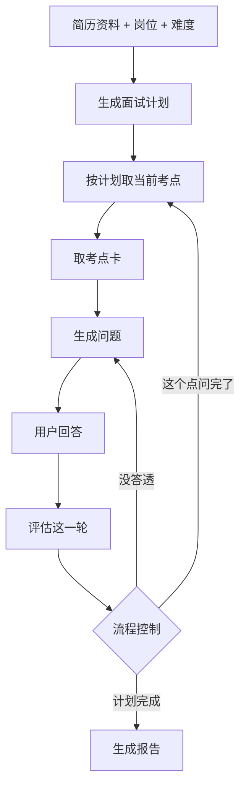

# 面试官设计

本文件记录 AI 模拟面试的出题与追问设计。目标是让面试像真人一样根据简历和刚才的回答推进，而不是用一个 API 加一段提示词自由发挥，也不是每轮都从题库抽固定题目。

简历处理、接口和表结构另见对应文档。本文件只约定面试官怎么工作。

## 原则

- 面试官手里先有一份这场要考的计划，问题从简历和上一轮回答里接出来。
- 答得好就往深处挖，答不上就给台阶或换方向。一个考点问够了，再转到下一个。
- 题库提供考点素材和评分依据，不直接把题目原文念给用户。
- 「下一步问什么」由代码里的规则决定，模型只负责评估这一轮、以及把问题说得自然。

## 职责拆分

| 部分 | 谁做 | 做什么 |
| --- | --- | --- |
| 计划 | 开场前一次模型调用 | 根据简历、岗位、难度列出本场考点、顺序和每段最多几轮 |
| 评估 | 用户每答完一次模型调用 | 判断覆盖了哪些要点、深度如何、哪里含糊、是否明确说了「不会」 |
| 流程控制 | Python 规则 | 决定追问、加深、给提示、换考点还是结束 |
| 措辞 | 另一次模型调用 | 按规则指定的动作生成下一问，不评价对错，不说出答案 |
| 题库 | 考点卡 | 提供要点、追问路线和常见误区；检索结果是素材，不是原题 |

## 流程

### 1. 开场前生成计划

用简历结构化资料、岗位和难度，让模型产出一份结构化计划，存进这场面试。用户看不到这份计划。计划决定本场问什么、问多久，所以每场不会一模一样。

示例结构：

- 开场：自我介绍，1 轮。
- 项目深挖：简历里的具体项目，考察其中的设计点，最多若干轮。
- 技术基础：与岗位相关的考点，各 2 到 3 轮。
- 场景题：结合岗位的一道设计题，若干轮。
- 收尾：候选人反问，1 轮。

### 2. 每轮先评估，再决定下一步

用户答完后，先单独调用一次模型，只做评估、不出题。输出固定结构：

- 覆盖了当前考点的哪些要点，漏了哪些。
- 深度打分。
- 含糊、可疑或答非所问的地方，并摘出原话。
- 用户是否明确说了「不会」。

然后由 Python 规则决定下一步，不把决定权交给模型：

| 情况 | 下一步 |
| --- | --- |
| 答得浅，但有可以继续挖的点 | 追问那个含糊的点 |
| 答得好 | 加深一层，例如从「怎么用」追到「为什么这样设计」 |
| 连续两次答不上 | 给一个提示，或降一级难度 |
| 这个点已经追问足够多次 | 转到下一个考点 |
| 当前阶段轮数用完 | 进入下一阶段 |

这张规则表就是面试官的性格。写在代码里，可以测试，也可以按难度调整。

### 3. 出题时模型只负责说话

最后一次模型调用只生成问题。输入包括：当前考点、这次动作（新问、追问、提示）、最近几轮对话、相关考点卡、简历片段。

问题素材有三个来源，计划里可以控制比例：

| 来源 | 典型问法 | 说明 |
| --- | --- | --- |
| 简历 | 「你简历里写了订单系统用 Redis 做缓存，不一致怎么处理？」 | 不依赖题库 |
| 题库 | 考基础时取一张考点卡，再和候选人经历连起来问 | 不念原题 |
| 刚才的回答 | 「你刚才说用了延迟双删，第二次删除失败怎么办？」 | 最像真人的部分 |

出题约束：

- 只做简短承接，不评价对错。
- 不说出答案。
- 不编造简历里没有的经历。

## 题库

题库存考点卡，不存「题目 + 标准答案」。一张卡包含：

- 考点名称、岗位标签、难度。
- 核心要点，作为评估和报告的依据。
- 追问路线，例如：是什么 → 为什么 → 什么时候会出问题 → 你的项目里怎么排查。
- 常见误区。

同一张卡可以从追问路线的不同位置切入，也可以和不同项目结合起来问。评估那一步直接使用卡上的核心要点，报告就有来源，不是模型凭空打分。

检索约束：

- 同一场已经问过的卡不再选。
- 该用户最近几场问过的卡降低权重。
- 从符合条件的若干张里挑选，而不是每次都取最相似的一张。

题库规模较小时，按「岗位 + 技能标签 + 难度」过滤即可。等题库变大，或需要把简历里自由写的技能名称匹配到卡片时，再加向量检索。题库内容可以先由模型批量生成，再人工筛选；卡片质量决定评分准不准。

## 数据

面试场次上保存计划和当前进度。每条用户回答上保存这一轮的评估结果。报告阶段汇总这些评估，不必再把整段对话交给模型重新判断。

## 代价

每轮至少两次模型调用：一次评估，一次出题。可以用更小的模型做评估，出题用流式输出，或在评估返回前先显示一句承接语。

## 开发顺序

1. 先做计划、每轮评估和流程控制。问题素材只来自简历。这一步用来验证追问是否自然。
2. 再加考点卡题库，先用标签过滤。
3. 最后加向量检索、跨场次去重和面试官风格。

第一步是骨架。题库是在骨架上补素材。顺序反过来，容易做成只会照着题库念题的系统。
